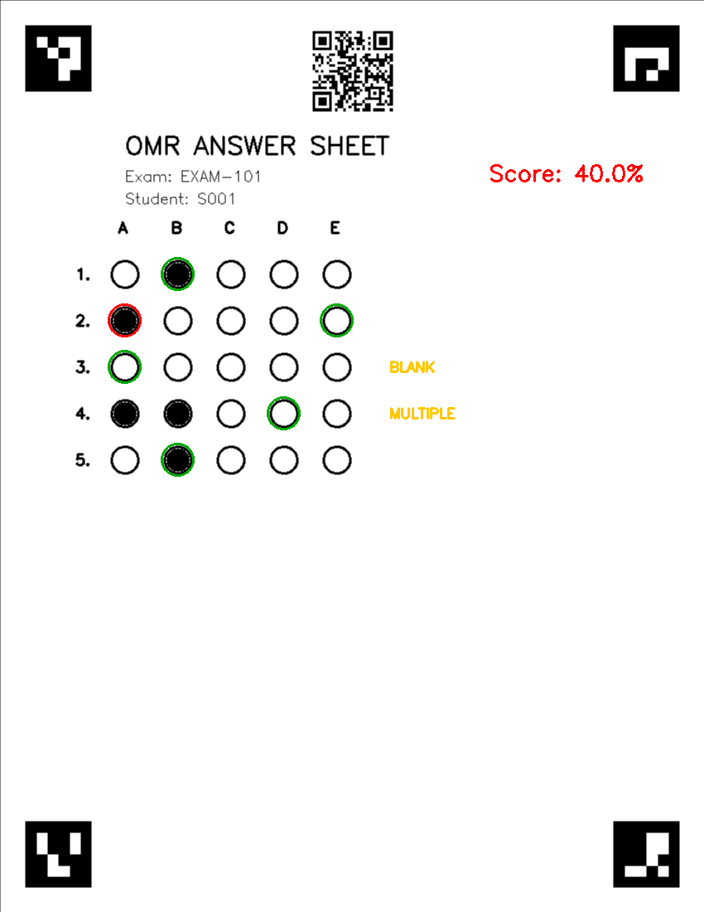

# SheetScanner — Automated OMR Test Grader

An end-to-end optical-mark-recognition (OMR) system that **generates** printable
bubble-sheet exams, **grades** them from a scan or phone photo, and produces
**per-student results plus item-analysis statistics** — exposed through a CLI, a
Streamlit web app and a **FastAPI service** used by the Java backend.



*Green = correct answer · Red = student's wrong choice · Yellow = flagged for review (blank / multiple-marked).*

## What it does

1. **Generate** answer sheets (`omr/sheet_generator.py`) with four corner **ArUco
   markers** (for a reliable perspective warp) and a **QR code** encoding the
   student id, exam id and `page_index`. Multi-page sheets are supported.
2. **Detect & warp** (`omr/detector.py`) — recover a perfect top-down view from a
   skewed photo using the ArUco markers, falling back to classic contour detection.
   **Each page is warped on its own** — pages are never stitched together.
3. **Grade** (`omr/grader.py`) — measure each bubble's *fill ratio* and classify every
   question as `CORRECT`, `WRONG`, `BLANK`, `MULTI_MARKED` or `AMBIGUOUS`.
   Multiple-choice questions (several correct answers) are graded by **exact set match**.
4. **Identify** (`omr/identity.py`) — decode the QR to tie each result to a student
   and to know which page it is.
5. **Analyse** (`omr/analytics.py`) — emit `results.csv`, per-question difficulty &
   distractor analysis, and a score-distribution histogram.

## How this differs from the original

This project began as a fork of the classic
[PyImageSearch bubble-sheet tutorial](https://pyimagesearch.com/2016/10/03/bubble-sheet-multiple-choice-scanner-and-test-grader-using-omr-python-and-opencv/),
which is a single notebook that grades one hard-coded 5-question image. The original
notebook is preserved in [`notebooks/`](notebooks/) for reference. Key changes:

| Original tutorial | This project |
|---|---|
| Picks the darkest bubble — **silently mis-grades blanks & double-marks** | Fill-ratio thresholds → explicit `BLANK` / `MULTI_MARKED` / `AMBIGUOUS` flags |
| Hard-coded 5-question answer key | YAML exam config (any size), validated; answer key may hold **sets** of options |
| Grades a single image via GUI `imshow` | Batch-grades a folder → CSV + item analysis; CLI, web app **and** HTTP service |
| Corner detection crashes if the paper contour isn't found | ArUco-marker warp (robust to skew) with contour fallback |
| No notion of *who* the sheet belongs to | QR-encoded student id + exam id + page index |
| No evaluation | Self-contained accuracy harness (`scripts/evaluate.py`) |

## Results

`scripts/evaluate.py` generates sheets with known random answers (incl. blanks and
double-marks), grades them, and compares against ground truth:

| Condition | Sheets located | Per-question accuracy | Blank/multiple recall |
|---|---|---|---|
| Flat | 200 / 200 | 100.0% | 100.0% |
| Distorted (simulated perspective + noise) | 200 / 200 | 100.0% | 100.0% |

> Note: "distorted" applies a synthetic perspective warp and Gaussian noise to imitate a
> phone photo; it is not a substitute for a real-camera test set, but it exercises the
> ArUco-based rectification path end-to-end.

## Quick start

```bash
python -m venv .venv && source .venv/bin/activate
pip install -r requirements.txt

# 1) make a printable sheet (ArUco markers + QR for student S001)
python cli.py generate --config config/exam_example.yaml --id S001

# 2) grade a single image or a whole folder
python cli.py grade --input data/samples --config config/exam_example.yaml --out data/output

# 3) web app
streamlit run app/streamlit_app.py

# 4) HTTP service (used by the Java backend)
uvicorn service.app:app --host 0.0.0.0 --port 8000

# 5) reproduce the evaluation
python scripts/evaluate.py --n 200 --distort
```

## HTTP service

`service/app.py` exposes SheetScanner to the Spring Boot backend. The service
**only reads images** — it never grades. It reports *what was marked*, the fill
ratios behind that decision and a confidence; the Java backend performs the
exact-set-match against the answer key.

### `POST /scan` — read one page

Multipart form:

| Field | Type | Mô tả |
|---|---|---|
| `paperExamId` | int | id đề (echo lại) |
| `actualQuestionCount` | int | tổng số câu của đề |
| `image` | file | **1 ảnh = 1 trang phiếu** |
| `choicesPerQ` | int | số lựa chọn mỗi câu (mặc định 4) |
| `questionsPerPage` | int | số câu mỗi trang |
| `layout` | JSON string | layout OMR |
| `pageIndex` | int | fallback khi QR không đọc được |
| `debug` | bool | trả thêm `rawOutput` |

Response:

```json
{
  "status": "SUCCESS",
  "paperExamId": 1,
  "actualQuestionCount": 16,
  "studentId": "S001",
  "examId": "EXAM-101",
  "pageIndex": 1,
  "warpMethod": "aruco",
  "recognizedAnswers": [
    { "questionIndex": 15, "selectedOptions": ["A", "C"], "isEmpty": false,
      "confidence": 0.95, "markedCount": 2,
      "fillRatios": [0.12, 0.91, 0.88, 0.05, 0.04],
      "status": "READ", "pageIndex": 1 }
  ],
  "rawOutput": null,
  "errors": []
}
```

> `questionIndex` là **số câu toàn cục** (`page_index * questions_per_page + row + 1`),
> nhờ vậy backend ghép các trang chỉ bằng cách union theo `questionIndex` —
> không phụ thuộc thứ tự upload.

### `POST /sheets/generate` — render printable sheets

JSON body: `examId`, `studentId`, `numQuestions`, `choicesPerQ`, `questionsPerPage`,
`layout`. Response chứa `pages[]` — mỗi phần tử là **1 PNG base64** (1 trang phiếu).

### `GET /health` — liveness probe.

## Exam configuration

Exams are plain YAML ([`config/exam_example.yaml`](config/exam_example.yaml)):

```yaml
exam_id: EXAM-101
num_questions: 5
choices_per_q: 5
# letters or 0-based ints; a LIST means "several correct answers"
answer_key: [B, [A, C], D, B, E]
questions_per_page: 5        # 0/omitted => single page
fill_threshold: 0.45          # min filled ratio to count a bubble as marked
ambiguity_margin: 0.12        # flag AMBIGUOUS if top-2 bubbles are this close
layout: { ... }               # bubble/marker geometry (px)
```

Both notations are accepted for `answer_key`:

- `answer_key: [B, E, A, D, B]` — legacy: mỗi phần tử là 1 đáp án đúng
- `answer_key: [B, [A, C], D]` — câu 2 có **2** đáp án đúng

### Grading semantics (multiple choice)

`MULTI_MARKED` **chỉ** áp dụng cho câu có đúng **1** đáp án đúng mà thí sinh tô nhiều ô.
Câu có nhiều đáp án đúng mà thí sinh tô đúng cả các ô đúng ⇒ `CORRECT`.

## Project structure

```
omr/
  config.py            exam config loading + validation (answer key as sets)
  geometry.py          single source of truth for bubble & marker coordinates
  sheet_generator.py   printable sheet: ArUco markers + QR + bubble grid (multi-page)
  detector.py          ArUco warp (contour fallback); reuses notebook transforms
  identity.py          QR decode: student id + exam id + page index
  grader.py            fill-ratio scoring + blank/multi-marked/ambiguous + annotation
  analytics.py         results.csv + item analysis + score histogram
service/app.py         FastAPI service: /scan, /sheets/generate, /health
app/streamlit_app.py   upload → graded results + CSV download
cli.py                 `generate` / `grade` commands
scripts/evaluate.py    self-contained accuracy harness
scripts/e2e_check.py   end-to-end check against the running Java backend
tests/                 config, grader (round-trip), identity, service
notebooks/             original PyImageSearch fork, kept for reference
```

## Testing

```bash
pytest          # 49 tests: config validation, classification logic, round-trip grading, QR, service
```

## End-to-end check

With the backend (`java -jar target/exam-0.0.1-SNAPSHOT.jar`) and this service
(`uvicorn service.app:app`) both running:

```bash
python scripts/e2e_check.py --base-url http://localhost:8080/api/v1
```

The script creates a paper exam, downloads the OMR sheet PDF, renders the filled
pages, uploads them **out of order** to `POST /paper-exams/{id}/scan` and verifies
every question's status against the real answer key (including a multi-correct
question and a blank one).

## Limitations / future work

- Single-column layout; multi-column sheets would need layout extension in `geometry.py`.
- Evaluation distortion is synthetic — a real photographed test set is the natural next step.
- A learned filled/empty classifier could replace the fill-ratio heuristic for noisy scans.
